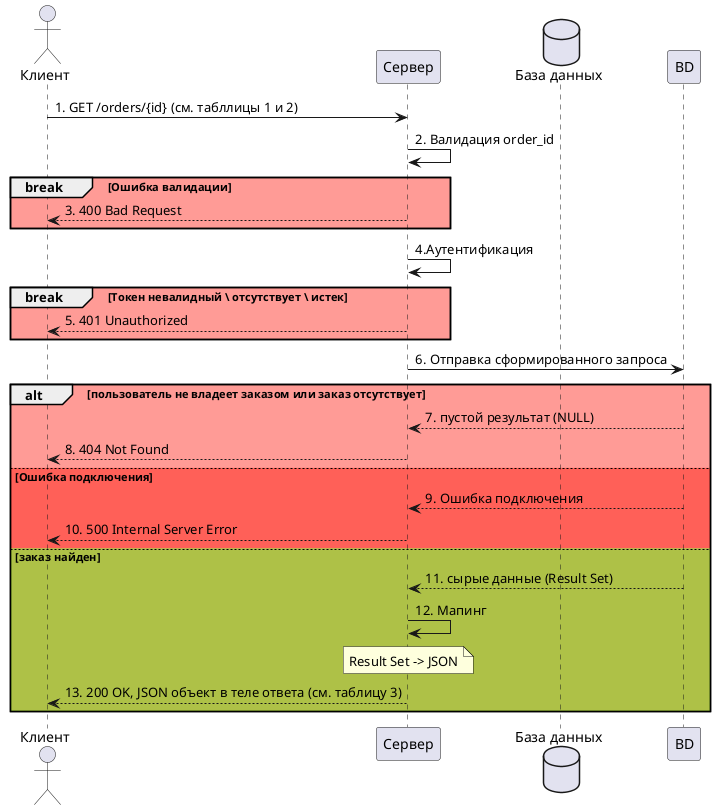
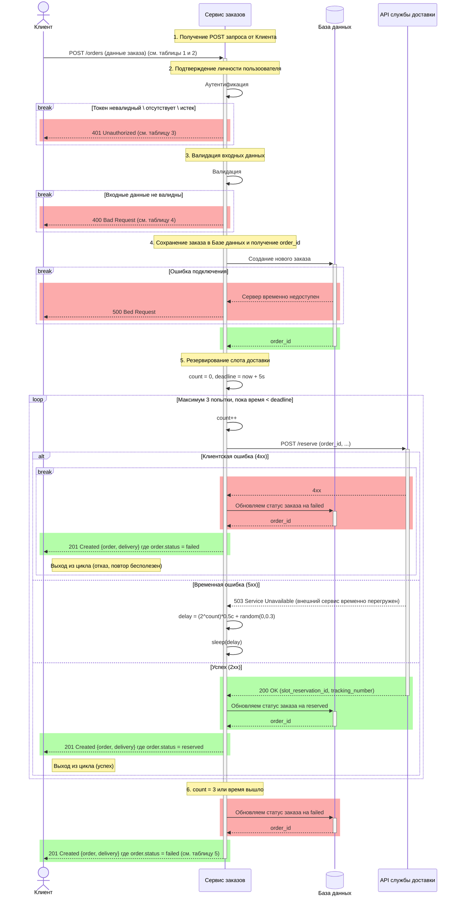

# Агрегатор заказов и службы доставки
## **GET запрос** 
Участники процесса: клиент, сервер, база данных.

## Диаграмма последовательности для GET меотда

```mermaid

sequenceDiagram
    actor C as Клиент
    participant S as Сервер
    participant BD@{ "alias" : "База данных", "type" : "database"} 
    C->>+S: 1. GET /orders/{id} (см. табллицы 1 и 2)
    S->>S: 2. Валидация order_id
    
    
    break Ошибка валидации
    rect rgba(250, 102, 102, 0.55)
    S-->>C: 3. 400 Bad Request
    end
    end
    S->>S: 4.Аутентификация
    break Токен невалидный \ отсутствует \ истек
    rect rgba(250, 102, 102, 0.55)
    S-->>C: 5. 401 Unauthorized
    end
    end
    S->>+BD: 6. Отправка сформированного запроса
    alt пользователь не владеет заказом или заказ отсутствует
    rect rgba(250, 102, 102, 0.55)
    BD-->>S: 7. пустой результат (NULL)
    S-->>C: 8. 404 Not Found
    end
    else Ошибка подключения
    rect rgba(250, 102, 102, 0.55)
    BD-->>S:  9. Ошибка подключения
    S-->>C: 10. 500 Internal Server Error
    end
    else заказ найден
    rect rgba(117, 252, 96, 0.54)
    BD-->>-S: 11. сырые данные (Result Set)
    end

     S->>S: 12. Мапинг
    Note over S: Result Set -> JSON
    rect rgba(117, 252, 96, 0.54)
    S-->>-C: 13. 200 OK, JSON объект в теле ответа (см. таблицу 3)
    end
    end
```



## 1. Таблица входных параметров (Input)
| Имя параметра | Тип данных | Обязательность | Описание |
| :--- | :--- | :--- | :--- |
| *order_id* | *String* | *Да* | *Идентификатор заказа* |

## 2. Таблица заголовков
| Имя параметра | Тип данных | Обязательность | Описание |
| :--- | :--- | :--- | :--- |
| *Authorization* | *String(Bearer Tocken)* | *Да* | *Токен доступа* |
| *Accept* | *String* | *Нет* | *Желаемый формат ответа* |
| *X-Request-ID* | *String* | *Нет* | *Идентификатор запроса* |

## 3. Таблица выходных параметров (Output)
| Имя параметра | Тип данных | Описание |
| :--- | :--- | :--- |
| *order* | *Object* | *Основная информация о заказе* |
| *order.id* | *String* | *Идентификатор заказа* |
| *order.status* | *String* | *Статус заказа* |
| *order.total* | *Number* | *Итоговая стоимость заказа* |
| *order.items* | *Array[Object]* | *Массив товаров в заказе* |
| *items[].id* | *String* | *Идентификатор товара* |
| *items[].name* | *String* | *Наименование товара* |
| *items[].quantity* | *String* | *Количество товара* |
| *items[].price* | *Number* | *Цена за единицу товара* |
| *delivery* | *Object* | *Данные о резервировании* |
| *delivery.slot_reservation_id* | *String* | *Идентификатор полученный на этапе резервирования слота доставки* |
| *delivery.tracking_number* | *String* | *Трекер-номер для отслеживания заказа* |


## **POST запрос**
Участники процесса: клиент, сервер, база данных, API службы доставки.

## Диаграмма последовательности для POST меотда


## 1. Таблица входных параметров (Input)
| Имя параметра | Тип данных | Обязательность | Описание |
| :--- | :--- | :--- | :--- |
| *comment* | *String* | *Нет* | *Комментарий к заказу* |
| *items* | *Array[Object]* | *Да* | *Массив товаров в заказе* |
| *items[].id* | *String* | *Да* | *Идентификатор товара* |
| *items[].quantity* | *String* | *Да* | *Количество товара* |


## 2. Таблица заголовков
| Имя заголовка | Тип данных | Обязательность | Описание |
| :--- | :--- | :--- | :--- |
| *Authorization* | *String(Bearer Token)* | *Да* | *Токен доступа* |
| *Accept* | *String* | *Нет* | *Желаемый формат ответа* |
| *X-Request-ID* | *String* | *Нет* | *Идентификатор запроса* |


## 3. Таблица ошибок авторизации (HTTP 401 Unauthorized)
| Заголовок | Условие ошибки | Error | Message
| :--- | :--- | :--- | :--- |
| *Authorization* | *Отсутствует или не в формате Bearer<токен>* | *MISSING_AUTH_HEADER* | *Обязателен и должен быть в формате Bearer<токен>* |
| *Authorizations* | *Токен истек* | *EXPIRED_AUTH_HEADER* | *Срок действия токена авторизации истек* |


## 4. Таблица ошибок валидации (HTTP 400 Bad Request)
| Имя параметра | Условие ошибки | Error | Message
| :--- | :--- | :--- | :--- |
| *items* | *Отсутствует или не является массивом* | *MISSING_ITEMS* | *Массив items обязателен* |
| *items* | *Массив пустой* | *EMPTY_ITEMS* | *Массив items должен содержать хотя бы 1 товар* |
| *items[].id* | *Отсутствует, путсая строка* | *MISSING_ITEM_ID* | *item[].id  обязателен и должен быть не пустой строкой* |
| *items[].id* | *Длина > 50* | *INVALID_ITEM_ID* | *item[].id  должен быть строкой не более 50 символов* |
| *items[].quantity* | *Отсутствует* | *MISSING_ITEM_QUANTITY* | *item[].quantity обязателен* |
| *items[].quantity* | *Не число, не целое, значение < 1* | *INVALID_ITEM_QUANTITY* | *item[].quantity должен быть целым числом (не менее 1)* |

## 5. Таблица выходных параметров (Output)
| Имя параметра | Тип данных | Описание |
| :--- | :--- | :--- |
| *order* | *Object* | *Основная информация о заказе* |
| *order.id* | *String* | *Идентификатор заказа* |
| *order.status* | *String* | *Статус заказа* |
| *order.total* | *Number* | *Итоговая стоимость заказа* |
| *order.items* | *Array[Object]* | *Массив товаров в заказе* |
| *items[].id* | *String* | *Идентификатор товара* |
| *items[].name* | *String* | *Наименование товара* |
| *items[].quantity* | *String* | *Количество товара* |
| *items[].price* | *Number* | *Цена за единицу товара* |
| *delivery* | *Object* | *Данные о резервировании* |
| *delivery.slot_reservation_id* | *String* | *Идентификатор полученный на этапе резервирования слота доставки* |
| *delivery.tracking_number* | *String* | *Трекер-номер для отслеживания заказа* |
