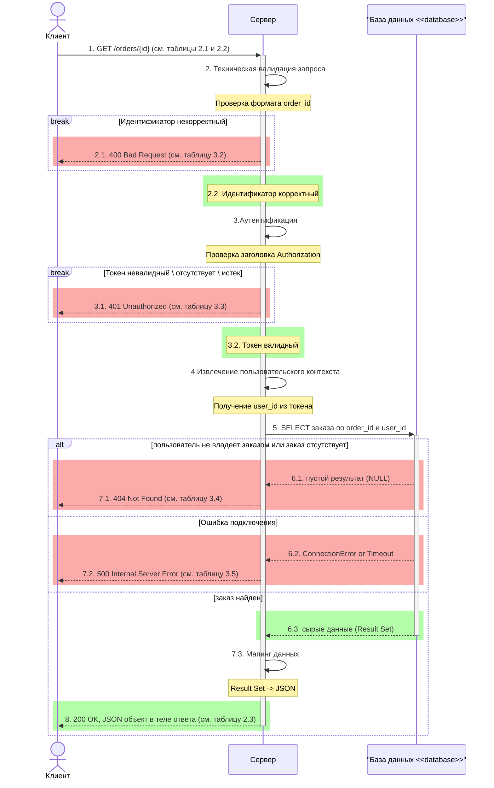
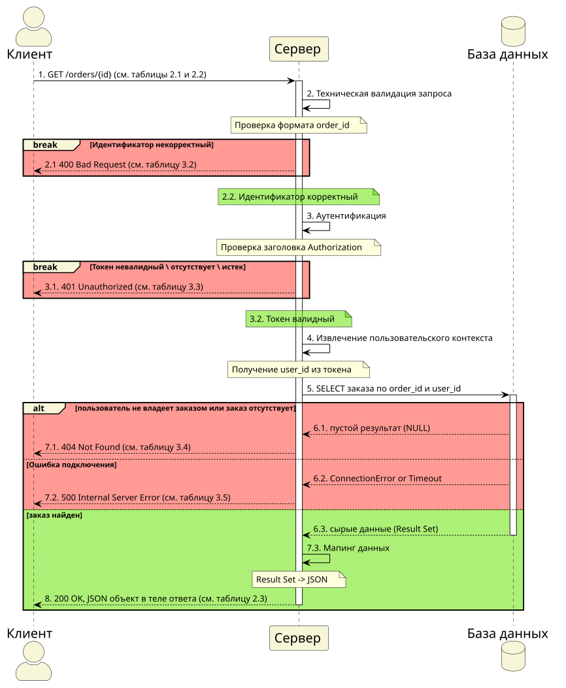
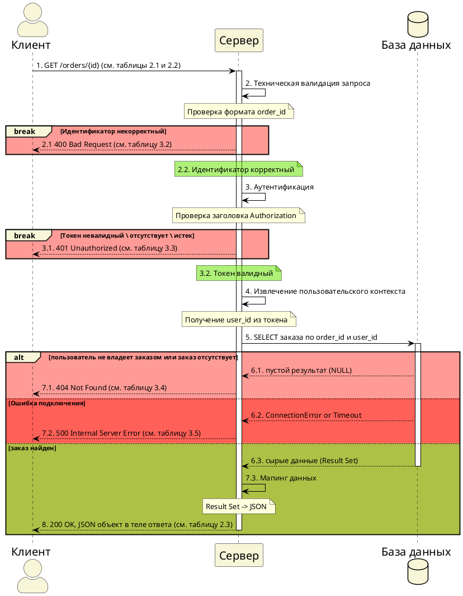
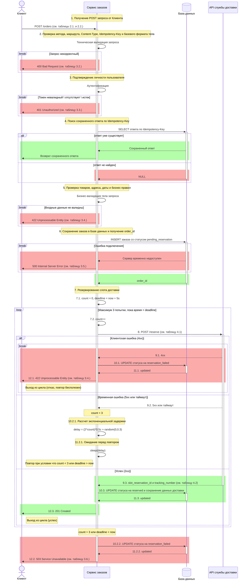
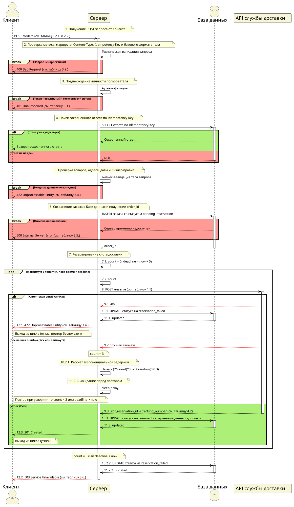
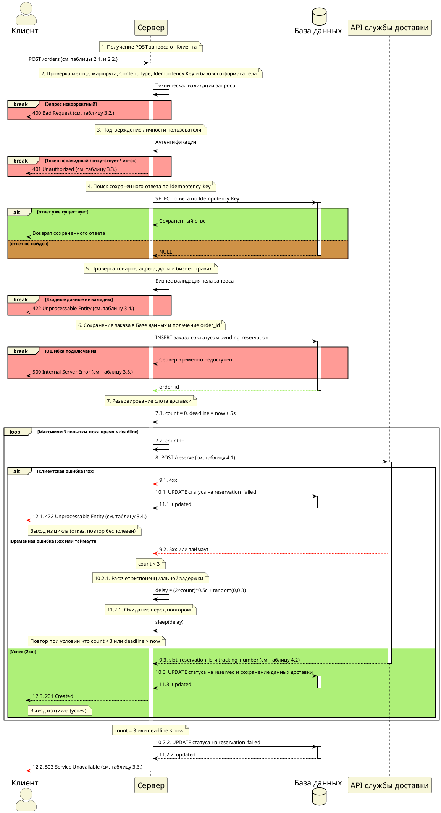

# Агрегатор заказов и службы доставки

# Задание 

## Агрегатор заказов и службы доставки
**Бизнес-контекст:** Система управления заказами в интернет-магазине. При создании заказа система сохраняет его в базу данных, а затем обращается к API внешней службы доставки для резервирования слота на курьерскую доставку. Известно, что сеть до API службы доставки нестабильна, и запросы периодически отваливаются по таймауту. Система не должна сразу отдавать ошибку пользователю при первом же сбое сети, она должна гарантировать, что попытка резервирования была предпринята должным образом перед окончательным подтверждением или отказом. Без резервирования доставки заказ не может быть создан.
*   **Методы:** `GET /orders/{id}` и `POST /orders`.

**Цель занятия:** Спроектировать взаимодействие компонентов системы (Sequence Diagram) на основе бизнес-требований к REST API.

**Формат сдачи работы:**
Один `.md` файл, содержащий:
1. **Две диаграммы последовательности** (в формате Mermaid.js): отдельно для `GET` метода и отдельно для второго метода (`POST`/`PUT`/`DELETE`).
2. **Таблицу контрактов API** (входные и выходные параметры для каждого вызова).
3. **Таблицу маппинга** (если бизнес-логика требует трансформации данных перед отправкой во внешние системы).

**Дополнительные условия:**
* Используйте явные блоки активации (Activation Boxes), чтобы показать время выполнения операций.
* Предусматривайте не только успешный сценарий (Happy Path), но и обработку ошибок. Выбор конкретных HTTP-кодов и логики отката остается на ваше усмотрение.
* Все взаимодействия с базой данных и внешними сервисами должны быть явно отражены на схеме.
* Параметры вызовов и их типы остаются на ваше усмотрение если явно не прописаны в задаче.
* Результата вызова и его типы остаются на ваше усмотрение если явно не прописаны в задаче.


## Шаблоны таблиц

### **Таблица входных параметров (Input)**
| Имя параметра | Тип данных | Обязательность | Описание |
| :--- | :--- | :--- | :--- |
| *Например: user_id* | *UUID* | *Да* | *Идентификатор пользователя* |

### **Таблица выходных параметров (Output)**
| Имя параметра | Тип данных | Описание |
| :--- | :--- | :--- |
| *Например: status* | *String* | *Статус операции* |

### **Таблица маппинга (если требуется по условию)**
| Поле нашей системы | Поле внешнего API | Логика преобразования |
| :--- | :--- | :--- |


# Решение

## **GET запрос** 
Метод `GET /orders/{id}` используется для получения информации о ранее созданном заказе по его идентификатору.

Участники процесса: клиент, сервер, база данных.

### 1. Диаграммы последовательности для GET метода
#### 1.1. Mermaid



### 1.2. PlantUML





### 2. Контракт метода

#### 2.1. Таблица входных параметров (Input)

| Имя параметра | Тип данных | Обязательность | Описание |
| :--- | :--- | :--- | :--- |
| `order_id` | String (формат UUID) | Да | Идентификатор заказа. Передается в пути запроса: `/orders/{order_id}` |

#### 2.2. Таблица заголовков

| Имя параметра | Тип данных | Обязательность | Описание |
| :--- | :--- | :--- | :--- |
| `Authorization` | String(Bearer Token) | Да | Токен доступа пользователя |
| `Accept` | String | Нет | Желаемый формат ответа: `application/json` |
| `X-Request-ID` | String | Нет | Идентификатор запроса для трассировки |

#### 2.3. Таблица выходных параметров (Output)

| Имя параметра | Тип данных | Описание |
| :--- | :--- | :--- |
| `order` | Object | Основная информация о заказе |
| `order.id` | String ( формат UUID) | Идентификатор заказа |
| `order.status` | String | Статус заказа: `reserved`, `pending_reservation`, `reservation_failed` |
| `order.total` | String (формат Decimal) | Итоговая стоимость заказа |
| `order.items` | Array[Object] | Массив товаров в заказе |
| `order.items[].id` | String | Идентификатор товара |
| `order.items[].name` | String | Наименование товара |
| `order.items[].quantity` | Number (формат Integer) | Количество товара |
| `order.items[].price` | String (формат Decimal) | Цена за единицу товара |
| `delivery` | Object | Данные о резервировании. Может отсутствовать, если доставка еще не зарезервирована |
| `delivery.address` | String | Адрес доставки, указанный клиентом |
| `delivery.date` | String | Желаемая дата доставки в формате `YYYY-MM-DD` |
| `delivery.slot_reservation_id` | String | Идентификатор полученный на этапе резервирования слота доставки |
| `delivery.tracking_number` | String | Трекер-номер для отслеживания заказа |


### 3. Ошибки

Все ошибки возвращаются в едином формате:

```json
{
  "error": "ERROR_CODE",
  "message": "Человекочитаемое описание ошибки"
}
```

#### 3.1. Таблица выходных параметров ошибки

| Имя параметра | Тип данных | Описание |
|:--|:--|:--|
| `error` | String | Машинно-читаемый код ошибки |
| `message` | String | Человекочитаемое описание ошибки |

#### 3.2. Таблица ошибок валидации, `400 Bad Request`
Возникают на этапе первичной проверки формата запроса.

| Имя параметра | Условие ошибки | Error | Message |
| :--- | :--- | :--- | :--- |
| `order_id` | Параметр отсутствует | `MISSING_ORDER_ID` | Параметр `order_id` обязателен |
| `order_id` | Параметр является пустой строкой | `EMPTY_ORDER_ID` | Параметр `order_id` не может быть пустым |
| `order_id` | Параметр имеет неверный формат | `INVALID_ORDER_ID_FORMAT` | Параметр `order_id` должен быть корректным идентификатором заказа |

#### 3.3. Таблица ошибок авторизации, `401 Unauthorized`
Возникают при проблемах с подтверждением личности пользователя (токеном).

| Имя параметра | Условие ошибки | Error | Message |
| :--- | :--- | :--- | :--- |
| `Authorization` | Заголовок отсутствует | `MISSING_AUTH_HEADER` | Заголовок `Authorization` обязателен |
| `Authorization` | Заголовок имеет неверный формат | `INVALID_AUTH_HEADER` | Заголовок `Authorization` должен быть в формате `Bearer <токен>` |
| `Bearer Token` | Токен имеет невалидный формат, поврежден или не проходит проверку подписи | `INVALID_AUTH_TOKEN` | Токен авторизации недействителен |
| `Bearer Token` | Срок жизни токена истек | `EXPIRED_AUTH_TOKEN` | Срок действия токена авторизации истек |

#### 3.4. Таблица ошибок доступа и поиска заказа, `404 Not Found`
Возникает когда запрашиваемый ресурс не существует или скрыт из соображений безопасности.

| Имя параметра | Условие ошибки | Error | Message |
| :--- | :--- | :--- | :--- |
| `order_id` | Заказ не найден | `ORDER_NOT_FOUND` | Заказ с таким идентификатором не найден |
| `order_id` | Заказ существует, но принадлежит другому пользователю (возврат `404` вместо `403`, чтобы не раскрывать факт существования чужого заказа) | `ORDER_NOT_FOUND` | Заказ с таким идентификатором не найден или недоступен |

#### 3.5. Таблица внутренних ошибок сервера, `500 Internal Server Error`
Возникают при критических сбоях на стороне сервера или его зависимостей.

| Имя параметра | Условие ошибки | Error | Message |
| :--- | :--- | :--- | :--- |
| `Database` | Ошибка подключения к базе данных | `DB_CONNECTION_ERROR` | Внутренняя ошибка сервиса |
| `Database` | Таймаут запроса к базе данных | `DB_TIMEOUT` | Внутренняя ошибка сервиса |
| `Server` | Непредвиденная ошибка обработки запроса | `INTERNAL_SERVER_ERROR` | Внутренняя ошибка сервиса |


## **POST запрос**
Метод используется для создания заказа. После валидации и сохранения заказа в базе данных система пытается зарезервировать слот доставки во внешнем API.

Если резервирование успешно, заказ считается созданным, и клиент получает `201 Created`.

Если служба доставки вернула окончательный отказ, клиент получает ошибку.

Если временная ошибка не устранена после нескольких попыток, клиент получает `503 Service Unavailable`.

Участники процесса: клиент, сервер, база данных, API службы доставки.

### 1. Диаграмма последовательности для POST метода
#### 1.1. Mermaid



#### 1.2. PlantUML





### 2. Контракт метода

#### 2.1. Таблица входных параметров (Input)
| Имя параметра | Тип данных | Обязательность | Описание |
| :--- | :--- | :--- | :--- |
| `comment` | String | Нет | Комментарий к заказу |
| `items` | Array[Object] | Да | Массив товаров в заказе |
| `items[].id` | String | Да | Идентификатор товара |
| `items[].quantity` | String | Да | Количество товара |
| `delivery` | Object | Да | Данные о резервировании |
| `delivery.address` | String | Да | Адрес доставки, указанный клиентом |
| `delivery.date` | String | Да | Желаемая дата доставки в формате `YYYY-MM-DD` |


#### 2.2. Таблица заголовков
| Имя заголовка | Тип данных | Обязательность | Описание |
| :--- | :--- | :--- | :--- |
| `Authorization` | String(Bearer Token) | Да | Токен доступа |
| `Idempotency-Key` | String (формат UUID) | Да | Ключ идемпотентности для защиты от повторного создания заказа |
| `Accept` | String | Нет | Желаемый формат ответа |
| `X-Request-ID` | String | Нет | Идентификатор запроса |


#### 2.3. Таблица выходных параметров (Output)

| Имя параметра | Тип данных | Описание |
| :--- | :--- | :--- |
| `order` | Object | Основная информация о заказе |
| `order.id` | String (формат UUID) | Идентификатор заказа |
| `order.status` | String | Статус заказа: `reserved`, `pending_reservation`, `reservation_failed` |
| `order.total` | String (формат Decimal) | Итоговая стоимость заказа |
| `order.items` | Array[Object] | Массив товаров в заказе |
| `order.items[].id` | String | Идентификатор товара |
| `order.items[].name` | String | Наименование товара |
| `order.items[].quantity` | Number (формат Integer) | Количество товара |
| `order.items[].price` | String (формат Decimal) | Цена за единицу товара |
| `delivery` | Object | Данные о резервировании |
| `delivery.address` | String | Адрес доставки, указанный клиентом |
| `delivery.date` | String | Желаемая дата доставки в формате `YYYY-MM-DD` |
| `delivery.slot_reservation_id` | String | Идентификатор полученный на этапе резервирования слота доставки |
| `delivery.tracking_number` | String | Трекер-номер для отслеживания заказа |


### 3. Контракт ошибок

Все ошибки возвращаются в едином формате:

```json
{
  "error": "ERROR_CODE",
  "message": "Человекочитаемое описание ошибки"
}
```

#### 3.1. Таблица выходных параметров ошибки
| Имя параметра | Тип данных | Описание |
|:--|:--|:--|
| `error` | String | Машинно-читаемый код ошибки |
| `message` | String | Человекочитаемое описание ошибки |

#### Таблица 3.2. Таблица ошибок технической валидации, `400 Bad Request`
Возникают на этапе первичной проверки формата запроса до обращения к бизнес-логике.

| Имя параметра | Условие ошибки | Error | Message |
| :--- | :--- | :--- | :--- |
| `HTTP Method` | Метод запроса не `POST` | `INVALID_METHOD` | Для создания заказа поддерживается только метод POST |
| `URL Path` | Маршрут не соответствует `/orders` | `INVALID_ROUTE` | Указанный маршрут не найден |
| `Content-Type` | Отсутствует или не является `application/json` | `INVALID_CONTENT_TYPE` | Тело запроса должно быть в формате `application/json` |
| `Idempotency-Key` | Отсутствует или имеет неверный формат | `INVALID_IDEMPOTENCY_KEY` | Заголовок `Idempotency-Key` обязателен и должен быть корректным |
| `Request body` | Тело отсутствует или содержит некорректный JSON | `MALFORMED_JSON` | Тело запроса должно быть корректным JSON-объектом |

---

#### Таблица 3.3. Таблица ошибок авторизации, `401 Unauthorized`
Возникают при проблемах с подтверждением личности пользователя (токеном).

| Имя параметра | Условие ошибки | Error | Message |
| :--- | :--- | :--- | :--- |
| `Authorization` | Заголовок отсутствует | `MISSING_AUTH_HEADER` | Заголовок `Authorization` обязателен |
| `Authorization` | Заголовок имеет неверный формат | `INVALID_AUTH_HEADER` | Заголовок `Authorization` должен быть в формате `Bearer <токен>` |
| `Bearer Token` | Токен имеет невалидный формат, поврежден или не проходит проверку подписи | `INVALID_AUTH_TOKEN` | Токен авторизации недействителен |
| `Bearer Token` | Срок жизни токена истек | `EXPIRED_AUTH_TOKEN` | Срок действия токена авторизации истек |

---

#### Таблица 3.4. Таблица ошибок бизнес-валидации, `422 Unprocessable Entity`
Возникают, когда синтаксис запроса верен, но бизнес-правила нарушены, либо когда внешнее API доставки возвращает клиентскую ошибку (4xx).

| Имя параметра | Условие ошибки | Error | Message |
| :--- | :--- | :--- | :--- |
| `items` | Массив товаров пуст, отсутствует или не является массивом | `EMPTY_ITEMS` | Заказ должен содержать хотя бы один товар |
| `items[].id` | Товар не найден или недоступен для заказа | `ITEM_NOT_FOUND` | Товар не найден или недоступен для заказа |
| `items[].quantity` | Количество меньше 1 или превышает доступный остаток на складе | `ITEM_OUT_OF_STOCK` | Некорректное количество или недостаточно товара на складе |
| `delivery` | Объект доставки пуст, отсутствует или не является объектом | `DELIVERY_NOT_FOUND` | Данные о резервировании должны быть заполнены |
| `delivery.address` | Адрес невалиден, не заполнены обязательные поля или находится вне зоны доставки | `DELIVERY_ADDRESS_UNAVAILABLE` | Адрес доставки некорректен или находится вне зоны обслуживания |
| `delivery.date` | Дата доставки недоступна или уже прошла | `DELIVERY_DATE_UNAVAILABLE` | Дата доставки должна быть в будущем и в пределах доступного расписания |

---

#### Таблица 3.5. Таблица ошибок подключения к базе данных, `500 Internal Server Error`
Возникают при критических сбоях на стороне сервера или его зависимостей.

| Имя параметра | Условие ошибки | Error | Message |
| :--- | :--- | :--- | :--- |
| `Database` | Ошибка подключения к базе данных | `DB_CONNECTION_ERROR` | Внутренняя ошибка сервиса |
| `Database` | Таймаут запроса к базе данных | `DB_TIMEOUT` | Внутренняя ошибка сервиса |
| `Server` | Непредвиденная ошибка обработки запроса | `INTERNAL_SERVER_ERROR` | Внутренняя ошибка сервиса |

---

#### Таблица 3.6. Таблица ошибок превышение лимитов резервирования `503 Service Unavailable`
Возникают, когда не удалось успешно зарезервировать слот доставки после исчерпания попыток или времени.

| Имя параметра | Условие ошибки | Error | Message |
| :--- | :--- | :--- | :--- |
| `Delivery API` | Превышено максимальное количество попыток (count = 3) из-за постоянных 5xx/таймаутов от API доставки | `DELIVERY_RESERVATION_RETRIES_EXCEEDED` | Превышено число попыток связи со службой доставки |
| `Delivery API` | Истек дедлайн ожидания (deadline < now, более 5 секунд) из-за долгих ответов API доставки | `DELIVERY_RESERVATION_TIMEOUT` | Превышено время ожидания ответа от службы доставки |


### 4. Таблица маппинга для внешнего API службы доставки

#### 4.1. Маппинг запроса к внешнему API

| Поле нашей системы | Поле внешнего API | Логика преобразования |
| :--- | :--- | :--- |
| `order.id` | `merchant_order_id` | Прямой маппинг. Идентификатор заказа, сгенерированный нашей системой, передается как строка без изменений. |
| `user_id` | `customer.id` | Прямой маппинг. Идентификатор пользователя извлекается из токена аутентификации и передается как строка. |
| `delivery.address` | `destination.address` | Прямой маппинг с нормализацией. Строка адреса передается как есть, но перед отправкой выполняется: удаление лишних пробелов, приведение к единому формату (например, "ул." вместо "улица"). |
| `delivery.date` | `slot.date` | Прямой маппинг. Дата в формате YYYY-MM-DD передается без изменений. |
| `items[].id` | `items[].sku` | Прямой маппинг с переименованием. Идентификатор товара из нашей системы передается как артикул (sku) во внешней системе. Значение не меняется. |
| `items[].quantity` | `items[].quantity` | Прямой маппинг. Целое число передается без изменений. |
| `items[].name` | `items[].description` | Обогащение. Если клиент не указал наименование товара, оно извлекается из каталога товаров по items[].id и передается как описание. Если наименование уже есть, передается как есть. |
| `order.total` | `declared_value` | Вычисление. Сумма рассчитывается сервером как SUM(items[].price * items[].quantity). Результат округляется до 2 знаков после запятой и передается как строка в формате десятичного числа. |
| `comment` | `comment` | Условный маппинг. Если комментарий указан и не пустой, он передается как строка. Если комментарий отсутствует или пустой, поле не включается в запрос. |
| `Idempotency-Key` | `X-Idempotency-Key` | Трансформация. Заголовок идемпотентности формируется как {Idempotency-Key}:{order_id}, где Idempotency-Key — ключ из запроса клиента, а order_id — идентификатор заказа. Это гарантирует уникальность вызова даже при повторной обработке одного и того же клиентского ключа. |

#### 4.2. Маппинг ответа внешней службы доставки

| Поле нашей системы | Поле внешнего API | Логика преобразования |
| :--- | :--- | :--- |
| `delivery.slot_reservation_id` | `slot_reservation_id` | Прямой маппинг. Передается как строка без изменений. Сохраняется в БД и возвращается клиенту. |
| `delivery.tracking_number` | `tracking_number` | Прямой маппинг. Передается как строка без изменений. Сохраняется в БД и возвращается клиенту. |

---

