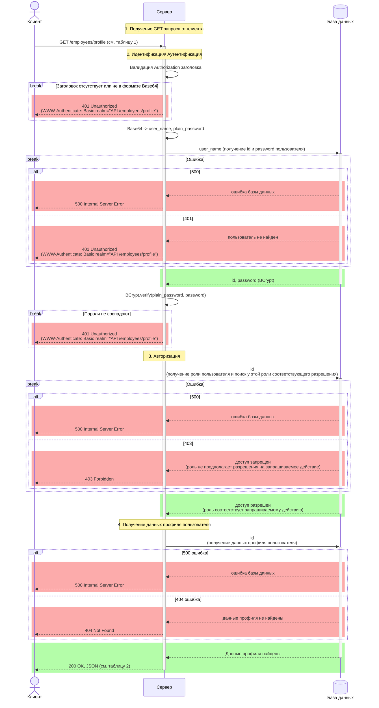

# Корпоративный портал профилей
## Задание 
**Бизнес-контекст:** Внутренний корпоративный портал для управления профилями сотрудников. Сотрудники могут просматривать свои данные. Доступ к сервису строго регламентирован политикой безопасности компании. Для контроля доступа используется стандартный механизм **HTTP Basic Authentication**. 
Это означает, что клиент обязан передавать учетные данные в закодированном виде (Base64) в HTTP-заголовке `Authorization`. Сервер не имеет права пропускать запрос к бизнес-логике или базе данных профилей, пока не декодирует эту строку и не проверит логин и хэш пароля по основной базе сотрудников.
*   **Методы:** `GET /employees/profile`.

**Цель занятия:** Спроектировать взаимодействие компонентов системы (Sequence Diagram) на основе бизнес-требований к REST API.

**Формат сдачи работы:**
Один `.md` файл, содержащий:
1. **Диаграмма последовательности** (в формате Mermaid.js): для `GET` метода.
2. **Таблицу контрактов API** (входные и выходные параметры для каждого вызова).
3. **Таблицу маппинга** (если бизнес-логика требует трансформации данных перед отправкой во внешние системы).

**Дополнительные условия:**
* Используйте явные блоки активации (Activation Boxes), чтобы показать время выполнения операций.
* Предусматривайте не только успешный сценарий (Happy Path), но и обработку ошибок. Выбор конкретных HTTP-кодов и логики отката остается на ваше усмотрение.
* Все взаимодействия с базой данных и внешними сервисами должны быть явно отражены на схеме.
* Параметры вызовов и их типы остаются на ваше усмотрение если явно не прописаны в задаче.
* Результата вызова и его типы остаются на ваше усмотрение если явно не прописаны в задаче.

## Шаблоны таблиц

### **Таблица входных параметров (Input)**
| Имя параметра | Тип данных | Обязательность | Описание |
| :--- | :--- | :--- | :--- |
| *Например: user_id* | *UUID* | *Да* | *Идентификатор пользователя* |

### **Таблица выходных параметров (Output)**
| Имя параметра | Тип данных | Описание |
| :--- | :--- | :--- |
| *Например: status* | *String* | *Статус операции* |

### **Таблица маппинга (если требуется по условию)**
| Поле нашей системы | Поле внешнего API | Логика преобразования |
| :--- | :--- | :--- |

## Решение

### Этапы выполнения GET запроса

Цель алгоритма — обработка GET-запроса к защищённому профилю пользователя, включающая этапы идентификации, аутентификации и авторизации. На всех этапах предусмотрена обработка ошибочных сценариев с возвратом соответствующих HTTP-статусов:

* 401 — при проблемах с учётными данными,
* 403 — при недостатке прав,
* 404 — если профиль не найден,
* 500 — при внутренней ошибке базы данных.

#### **Отправка запроса на Сервер**
1. Клиент посылает Серверу GET запрос с Basic Auth.
#### **Идентификация/ Аутентификация **
2. Сервер обрабатывает Basic Auth.
* Если заголовок отсутствует или не в формате Base64, сервер возвращает клиенту 401 Unauthorized (WWW-Authenticate: Basic realm="API /employees/profile").
* Если заголовок найден, сервер извлекает часть после Basic (пробел обязателен)  - это Base64 строка. Декодирует ее в байты, затем в строку username: password. Разбивает строку по двоеточию, получая логин и пароль.
3. Сервер отправляет запрос в Базу данных на поиск пользователя по логину.
* Если ошибка Базы данных, Сервер возвращает Клиенту 500 Internal Server Error.
* Если пользователь не найден, Сервер возвращает Клиенту 401 Unauthorize (WWW-Authenticate: Basic realm="API /employees/profile").
* Если пользователь найден, База данных возвращает Серверу хешированный пароль(BCrypt).
4. Сервер сравнивает пароли (BCrypt.verify(plain_password, password)).
* Если пароли не совпадают, Сервер возвращает Клиенту 401 Unauthorized (WWW-Authenticate: Basic realm="API /employees/profile").
* Если пароли совпадают, Сервер переходит к следующему шагу.
#### **Авторизация**
5. Сервер делает запрос в Базу данных для определения роли пользователя и прав на получение данных.
* Если ошибка Базы данных, Сервер возвращает Клиенту 500 Internal Server Error.
* Если у пользователя нет прав на получение данных, Сервер возвращает Клиенту 403 Forbidden (доступ запрещен).
* Если у пользователя есть права на получение данных, Сервер переходит к следующему шагу.
#### **Получение данных пользователя**
6. Сервер запрашивает данные по профилю пользователя в Базе данных.
* Если возникает ошибка Базы данных, Сервер возвращает Клиенту 500 Internal Server Error.
* Если профиль не найден, Сервер возвращает Клиенту 404 Not Found
* Если данные профиля найдены, Сервер возвращает Клиенту 200 ОК и ответ в формате JSON.

### Mermaid диаграмма последовательности GET запроса

### 1. Таблица заголовков
| Имя заголовка | Тип данных | Обязательность | Описание |
| :--- | :--- | :--- |:--- |
| *Authorization* | *String(Basic Auth)* | *Да* | *Содержит учетные данные для аутентификации. Формат: Basic <base64-строка>, где <base64-строка> - это username: password закодированный в Base64* |
| *Accept* | *String* | *Нет* | *Желаемый формат ответа Формат: aplication/json* |
| *X-Request-ID* | *String* | *Нет* | *Идентификатор запроса* |

### 2. Таблица выходных параметров (Output)
| Имя параметра | Тип данных | Описание |
| :--- | :--- | :--- |
| *id* | *String* | *Идентификатор сотрудника в системе* |
| *user_name* | *String* | *Логин пользователя* |
| *full_name* | *String* | * Логин пользователя* |
| *position* | *String* | *Название занимаемой должности* |
| *email* | *String* | *Корпоративный электронный адрес сотрудника* |
| *phone* | *String* | *Контактный рабочий номер телефона сотрудника* |

