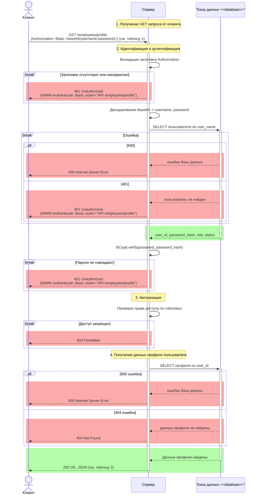

# Корпоративный портал профилей
## Задание 
**Бизнес-контекст:** Внутренний корпоративный портал для управления профилями сотрудников. Сотрудники могут просматривать свои данные. Доступ к сервису строго регламентирован политикой безопасности компании. Для контроля доступа используется стандартный механизм **HTTP Basic Authentication**. 
Это означает, что клиент обязан передавать учетные данные в закодированном виде (Base64) в HTTP-заголовке `Authorization`. Сервер не имеет права пропускать запрос к бизнес-логике или базе данных профилей, пока не декодирует эту строку и не проверит логин и хэш пароля по основной базе сотрудников.
*   **Методы:** `GET /employees/profile`.

**Цель занятия:** Спроектировать взаимодействие компонентов системы (Sequence Diagram) на основе бизнес-требований к REST API.

**Формат сдачи работы:**
Один `.md` файл, содержащий:
1. **Диаграмма последовательности** (в формате Mermaid.js): для `GET` метода.
2. **Таблицу контрактов API** (входные и выходные параметры для каждого вызова).
3. **Таблицу маппинга** (если бизнес-логика требует трансформации данных перед отправкой во внешние системы).

**Дополнительные условия:**
* Используйте явные блоки активации (Activation Boxes), чтобы показать время выполнения операций.
* Предусматривайте не только успешный сценарий (Happy Path), но и обработку ошибок. Выбор конкретных HTTP-кодов и логики отката остается на ваше усмотрение.
* Все взаимодействия с базой данных и внешними сервисами должны быть явно отражены на схеме.
* Параметры вызовов и их типы остаются на ваше усмотрение если явно не прописаны в задаче.
* Результата вызова и его типы остаются на ваше усмотрение если явно не прописаны в задаче.

## Шаблоны таблиц

### **Таблица входных параметров (Input)**
| Имя параметра | Тип данных | Обязательность | Описание |
| :--- | :--- | :--- | :--- |
| *Например: user_id* | *UUID* | *Да* | *Идентификатор пользователя* |

### **Таблица выходных параметров (Output)**
| Имя параметра | Тип данных | Описание |
| :--- | :--- | :--- |
| *Например: status* | *String* | *Статус операции* |

### **Таблица маппинга (если требуется по условию)**
| Поле нашей системы | Поле внешнего API | Логика преобразования |
| :--- | :--- | :--- |

## Решение
## 1. Этапы выполнения GET-запроса

Метод `GET /employees/profile` возвращает профиль текущего аутентифицированного сотрудника. Идентификатор сотрудника в запросе не передаётся, так как определяется сервером на основе учётных данных из заголовка `Authorization`.

Цель алгоритма — обработка защищённого GET-запроса, включающая идентификацию, аутентификацию, авторизацию и получение профиля. Для ошибочных сценариев предусмотрены следующие коды состояния:

- `401 Unauthorized` — отсутствует заголовок, некорректный формат учётных данных, пользователь не найден или пароль неверный;
- `403 Forbidden` — пользователь аутентифицирован, но не имеет права на доступ к профилю;
- `404 Not Found` — пользователь аутентифицирован, но профиль не найден;
- `500 Internal Server Error` — внутренняя ошибка сервера или базы данных.

### Отправка запроса
1. Клиент отправляет серверу запрос `GET /employees/profile` с заголовком `Authorization: Basic <base64(username:password)>`.

### Идентификация и аутентификация
2. Сервер проверяет наличие заголовка `Authorization` и схему `Basic`.  
   Если заголовок отсутствует, схема некорректна, значение не является допустимой Base64-строкой или после декодирования невозможно получить пару `username:password`, сервер возвращает `401 Unauthorized` с заголовком `WWW-Authenticate: Basic realm="employees/profile"`.

3. Сервер декодирует Base64-значение в UTF-8 и разделяет его по первому двоеточию на `username` и `password`.

4. Сервер выполняет запрос к базе данных для получения записи пользователя по `username`.  
   Возможные результаты:
   - ошибка базы данных — сервер возвращает `500 Internal Server Error`;
   - пользователь не найден — сервер возвращает `401 Unauthorized`;
   - пользователь найден — сервер получает `user_id`, хеш пароля и данные для авторизации.

5. Сервер выполняет проверку пароля с использованием `BCrypt.verify(plain_password, password_hash)`.  
   Если пароль не совпадает, сервер возвращает `401 Unauthorized`.  
   Сервер не раскрывает клиенту различие между «пользователь не найден» и «неверный пароль».

### Авторизация
6. Сервер проверяет, что пользователь имеет право на доступ к профилю.  
   Например, пользователь имеет статус `ACTIVE` и право на чтение собственного профиля.  
   Если доступ запрещён, сервер возвращает `403 Forbidden`.

### Получение профиля
7. Сервер запрашивает профиль пользователя в базе данных по `user_id`.  
   Возможные результаты:
   - ошибка базы данных — сервер возвращает `500 Internal Server Error`;
   - профиль не найден — сервер возвращает `404 Not Found`;
   - профиль найден — сервер возвращает `200 OK` и JSON с данными профиля.


### 2. Mermaid диаграмма последовательности GET запроса


### 3. Контракт метода

### 3.1. Таблица заголовков
| Имя заголовка | Тип данных | Обязательность | Описание |
| :--- | :--- | :--- |:--- |
| `Authorization` | String(Basic Auth) | Да | Содержит учетные данные для аутентификации. Формат: Basic <base64-строка>, где <base64-строка> - это username: password закодированный в Base64 |
| `Accept` | String | Нет | Желаемый формат ответа Формат: aplication/json |
| `X-Request-ID` | String | Нет | Идентификатор запроса |

### 3.2. Таблица выходных параметров (Output)
| Имя параметра | Тип данных | Описание |
| :--- | :--- | :--- |
| `id` | String (формат  UUID) | Идентификатор сотрудника в системе |
| `user_name` | String | Логин пользователя |
| `full_name` | String | Полное имя сотрудника |
| `position` | String | Название занимаемой должности |
| `email` | String | Корпоративный электронный адрес сотрудника |
| `phone` | String | Контактный рабочий номер телефона сотрудника |


### 4. Контракт ошибок

### 4.1. Таблица выходных параметров ошибки

| Имя параметра | Тип данных | Описание |
| :--- | :--- | :--- |
| `error` | String | Машинно-читаемый код ошибки |
| `message` | String | Человекочитаемое описание ошибки |

---

### 4.2. Ошибки 400 Bad Request

| Имя параметра | Условие ошибки | Error | Message |
| :--- | :--- | :--- | :--- |
| `X-Request-ID` | Заголовок присутствует и имеет некорректный формат | `INVALID_REQUEST_ID` | Заголовок `X-Request-ID` должен быть корректным строковым идентификатором запроса |
| Query parameters | Переданы непредусмотренные параметры запроса | `UNEXPECTED_QUERY_PARAMETER` | Метод `GET /employees/profile` не поддерживает параметры запроса |
| Request body | Передано тело запроса, хотя контракт не предусматривает тело для `GET` | `UNEXPECTED_REQUEST_BODY` | Метод `GET /employees/profile` не должен содержать тело запроса |

---

### 5.2. Ошибки 401 Unauthorized

Для всех ответов `401 Unauthorized` должен возвращаться заголовок:

```http
WWW-Authenticate: Basic realm="API /employees/profile"
```

| Имя параметра | Условие ошибки | Error | Message |
| :--- | :--- | :--- | :--- |
| `Authorization` | Заголовок отсутствует | `MISSING_AUTHORIZATION` | Требуется заголовок `Authorization` с учётными данными Basic Auth |
| `Authorization` | Схема аутентификации не `Basic` | `UNSUPPORTED_AUTH_SCHEME` | Поддерживается только схема аутентификации `Basic` |
| `Authorization` | Значение не соответствует формату `Basic <base64>` | `MALFORMED_AUTHORIZATION` | Значение заголовка `Authorization` должно быть в формате `Basic <base64>` |
| `Authorization` | Base64-часть не может быть декодирована | `MALFORMED_AUTHORIZATION` | Учётные данные в заголовке `Authorization` не могут быть обработаны |
| `Authorization` | Декодированная строка не содержит разделитель `:` | `MALFORMED_CREDENTIALS` | Учётные данные должны быть представлены в формате `username:password` |
| `Authorization` | Имя пользователя или пароль пусты | `INVALID_CREDENTIALS` | Неверное имя пользователя или пароль |
| `Authorization` | Пользователь не найден или пароль неверен | `INVALID_CREDENTIALS` | Неверное имя пользователя или пароль |

> Для безопасности не следует возвращать разные коды для случаев «пользователь не найден» и «неверный пароль». Внешний ответ должен быть одинаковым: `INVALID_CREDENTIALS`.

---

### 5.3. Ошибки 403 Forbidden

| Имя параметра | Условие ошибки | Error | Message |
| :--- | :--- | :--- | :--- |
| Права пользователя | У пользователя нет права просматривать профиль | `ACCESS_DENIED` | Недостаточно прав для получения профиля сотрудника |
| Права пользователя | Пользователь пытается получить чужой профиль, если доступ разрешён только к своему профилю | `PROFILE_ACCESS_DENIED` | Доступ к запрошенному профилю запрещён |
| Статус пользователя | Учётная запись пользователя заблокирована или неактивна | `ACCOUNT_DISABLED` | Учётная запись пользователя заблокирована или неактивна |

---

### 5.4. Ошибки 404 Not Found

| Имя параметра | Условие ошибки | Error | Message |
| :--- | :--- | :--- | :--- |
| URL Path | Маршрут не соответствует `/employees/profile` | `INVALID_ROUTE` | Указанный маршрут не найден |
| Профиль сотрудника | Профиль не найден для текущего пользователя | `PROFILE_NOT_FOUND` | Профиль сотрудника не найден |

---

### 5.5. Ошибки 405 Method Not Allowed

Для ответа должен возвращаться заголовок:

```http
Allow: GET
```

| Имя параметра | Условие ошибки | Error | Message |
| :--- | :--- | :--- | :--- |
| HTTP Method | Метод запроса не `GET` | `INVALID_METHOD` | Для получения профиля сотрудника поддерживается только метод `GET` |

---

### 5.6. Ошибки 406 Not Acceptable

| Имя параметра | Условие ошибки | Error | Message |
| :--- | :--- | :--- | :--- |
| `Accept` | Заголовок присутствует и не является `application/json` | `INVALID_ACCEPT` | Сервер возвращает данные только в формате `application/json` |

---

### 5.7. Ошибки 500 Internal Server Error

| Имя параметра | Условие ошибки | Error | Message |
| :--- | :--- | :--- | :--- |
| База данных | Непредвиденная ошибка при обращении к БД | `INTERNAL_ERROR` | Внутренняя ошибка сервера при обработке запроса |
| Сервер | Непредвиденная ошибка обработки запроса | `INTERNAL_ERROR` | Внутренняя ошибка сервера при обработке запроса |

> Клиенту не следует раскрывать технические детали ошибки базы данных. Внешний контракт должен возвращать обобщённый код, например `INTERNAL_ERROR`.

---


Маппинг не требуется, так как данные возвращаются клиенту напрямую из базы данных без передачи во внешние системы.

## 8. Примечания по безопасности

1. Эндпоинт должен быть доступен только по HTTPS.
2. Base64 не является шифрованием, поэтому передача учётных данных без TLS недопустима.
3. Заголовок `Authorization` не должен попадать в логи в исходном виде.
4. Пароли должны храниться в виде хэшей, например `BCrypt`.
5. Для случаев «пользователь не найден» и «неверный пароль» следует возвращать одинаковый код ошибки, чтобы не раскрывать существование учётной записи.
6. Технические детали ошибок БД не должны возвращаться клиенту.
